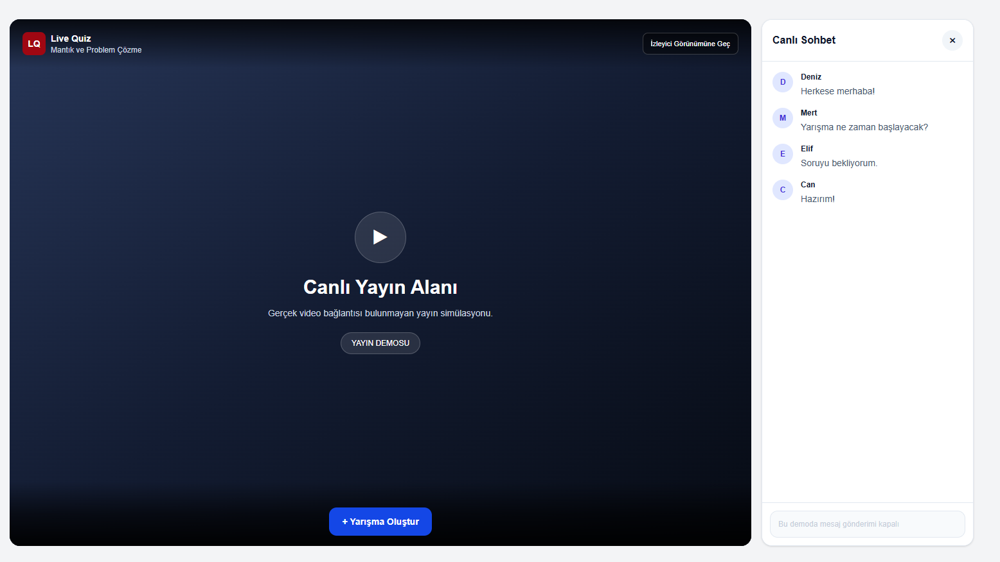
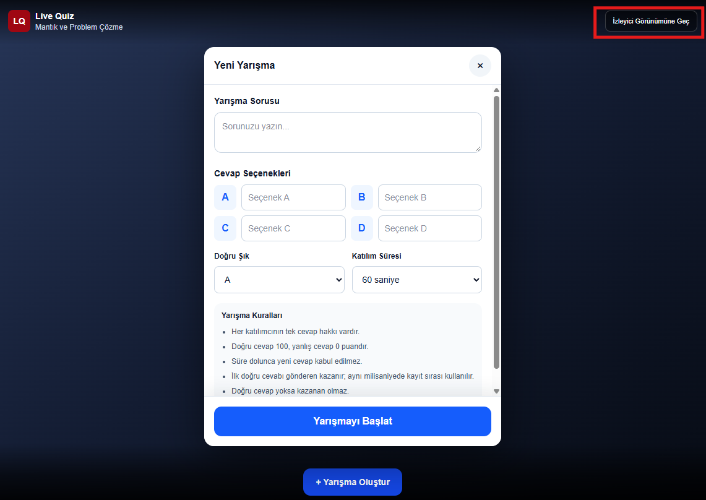
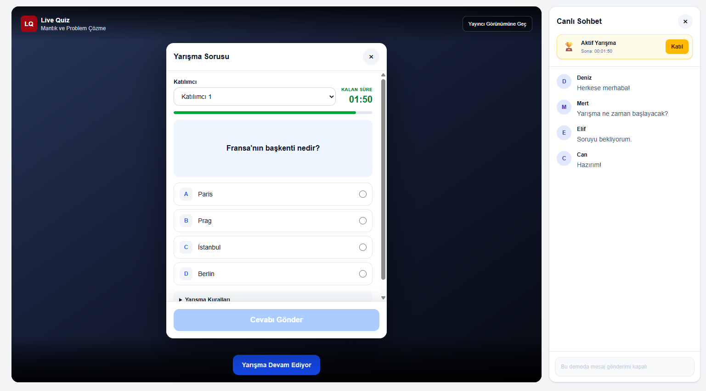
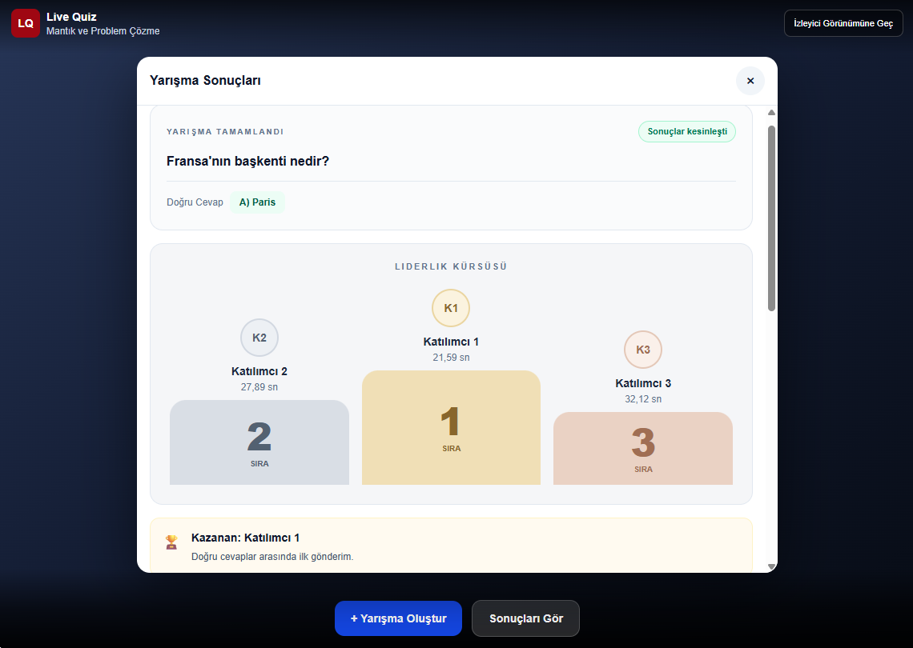
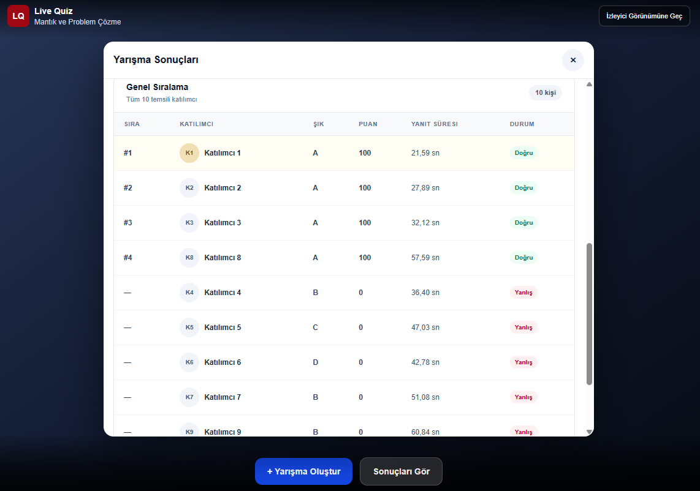
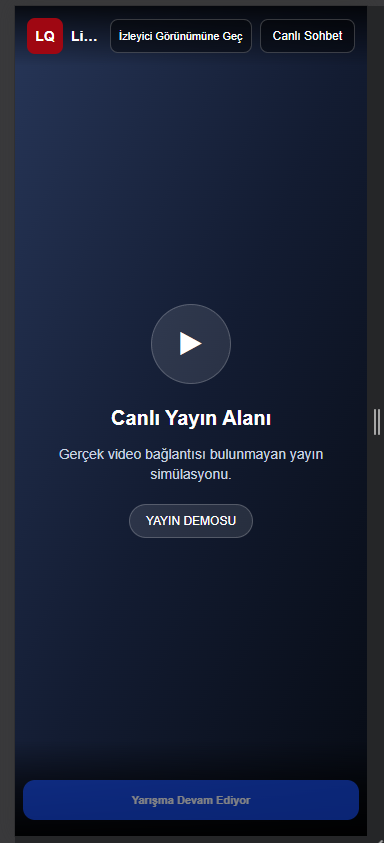
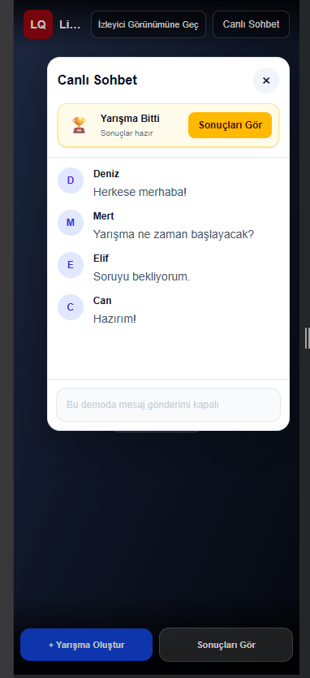

<div align="center">

<h1>🎯 Live Quiz</h1>

<h3>Eğitici Canlı Yayınlar İçin Yarışma Prototipi</h3>

<p>Yayıncının yarışma başlatabildiği, izleyicilerin süre içinde yanıt verdiği ve kazananın önceden belirlenen kurallarla açıklandığı interaktif bir <strong>Next.js + Supabase</strong> prototipi.</p>

<p>
  <a href="https://live-quiz-weld.vercel.app/">
    
  </a>
  <a href="https://github.com/Ayseorkan/live-quiz">
    
  </a>
</p>


<p align="center">
  <a href="https://nextjs.org/" target="_blank">
    
  </a>
  <a href="https://react.dev/" target="_blank">
    
  </a>
  <a href="https://www.typescriptlang.org/" target="_blank">
    
  </a>
  <a href="https://tailwindcss.com/" target="_blank">
    
  </a>
  <a href="https://supabase.com/" target="_blank">
    
  </a>
  <a href="https://www.postgresql.org/" target="_blank">
    
  </a>
  <a href="https://vercel.com/" target="_blank">
    
  </a>
</p>


</div>

---


> [!IMPORTANT]
> **Canlı Demo Linki:** [https://live-quiz-weld.vercel.app](https://live-quiz-weld.vercel.app)
>
> 🎭 **Yayıncı ve İzleyici Modlarını Deneyin!**
>
> Canlı demoda sağ üst köşedeki butonu kullanarak **Yayıncı ↔ İzleyici** görünümleri arasında geçiş yapabilirsiniz. Her iki deneyimi de keşfetmek için modları değiştirmeyi unutmayın!


<!-- EKRAN GÖRÜNTÜSÜ 1: Masaüstünde lacivert yayın alanı + sağda açık sohbet. -->


## Özellikler

- Tek soru, **A / B / C / D** seçenekleri ve tek doğru cevap.
- Yayıncı tarafından seçilebilen **30, 60 veya 1a20 saniyelik** yarışma süresi.
- **10 temsili katılımcı**; her katılımcı için yarışma başına yalnızca bir cevap hakkı.
- Sunucu/veritabanı zamanına göre cevap kabulü; süre bitince yeni cevapların reddi.
- Aynı yayın bağlamında **aynı anda yalnızca bir aktif yarışma** oluşturulabilmesi.
- Yarışma bitince otomatik açılan; kapatılıp yeniden görüntülenebilen sonuç ekranı.
- İlk üç doğru yanıtı gösteren **liderlik kürsüsü**, 10 kişilik sıralama tablosu ve kazananın gerekçesi.
- Masaüstünde yan panel, mobilde sağdan açılan kompakt sohbet widget'ı.
- Yarışma bağlantısının `?contestId=...` üzerinden paylaşılabilmesi.

## Nasıl çalışır?

### 1. Yarışma oluşturma

Yayıncı **Yarışma Oluştur** düğmesinden soruyu, dört seçeneği, doğru cevabı ve süreyi belirler. Yarışma başladıktan sonra ikinci bir yarışma oluşturulamaz; mevcut yarışma bittiğinde düğme yeniden kullanılabilir. Sağ üstteki butondan izleiyici ve yayıncı görünümü değişimi yapılabilir.

<!-- EKRAN GÖRÜNTÜSÜ 2: Doldurulmuş yarışma oluşturma widget'ı, başlatma düğmesi de görünür. -->


### 2. Yarışmaya katılma

Katılımcı, aktif yarışmayı açar; 1–10 arasından temsili katılımcısını seçer ve geri sayım devam ederken **tek bir şık gönderir**. Bir kez kaydedilmiş cevap değiştirilemez. Şık seçmek tek başına kayıt oluşturmaz; **Cevabı Gönder** işlemine basılması gerekir.

<!-- EKRAN GÖRÜNTÜSÜ 3: Aktif yarışma, süre sayacı, dört şık ve Cevabı Gönder düğmesi aynı karede. -->


### 3. Sonuçları görüntüleme

Süre bitince cevap kabulü sona erer ve sonuçlar hesaplanır. Sonuç widget'ı otomatik açılır, **X** ile kapatılabilir. Doğru cevap, kazananın gerekçesi, ilk üç kürsüsü ve bütün katılımcılar için sonuç tablosu gösterilir. Hiç doğru cevap yoksa **Kazanan yok** durumu gösterilir.

<!-- EKRAN GÖRÜNTÜSÜ 4: En az 3 katılımcının doğru yanıt verdiği yarışmanın kürsüsü ve altındaki sıralama tablosu. -->



### 4. Mobil görünüm

Mobil ekranda yayın alanı ön plandadır. Sohbet, sağ üstteki düğmeden **sağda kompakt bir pencere** olarak açılır ve kapatılır; yarışma widget'ları da küçük ekranlara uyarlanır.

<!-- EKRAN GÖRÜNTÜSÜ 5: Telefon ekranında sağ tarafta açık olan sohbet widget'ı. -->



## Değerlendirme kuralları

| Durum | Kural |
|---|---|
| Doğru cevap | **100 puan** |
| Yanlış cevap | **0 puan** |
| Cevap göndermeyen | Sıralamada **Katılmadı** olarak görünür |
| Tekrar cevap | İlk kayıt korunur; ikinci gönderim reddedilir (`409`) |
| Süre dolduktan sonra cevap | Reddedilir (`410`) |
| Birden fazla doğru cevap | Doğru yanıt verenler **geçerli gönderim zamanına** göre sıralanır |
| Eşit gönderim zamanı | Veritabanındaki **cevap kayıt sırası / ID** belirleyicidir |
| Kazanan | En erken geçerli doğru cevabı veren **tek katılımcı** |
| Doğru cevap yok | **Kazanan yok** |

> **Adalet ve sınırlar:** Sıralamada cevapların sunucuya ulaşma zamanı esas alındığı için ağ gecikmesi sonucu etkileyebilir. Bu durum, prototipin bilinen bir sınırlamasıdır. Yayıncı sonuçları manuel değiştiremez.

## Teknolojiler

| Katman | Teknoloji |
|---|---|
| Arayüz | Next.js (App Router), React, TypeScript, Tailwind CSS |
| API | Next.js Route Handlers |
| Veritabanı | Supabase PostgreSQL |
| Veri erişimi | Sunucu tarafında Supabase istemcisi |
| Test | PowerShell API smoke testleri (`tests/smoke.ps1`) |

**Temel veri modeli:** `contests` yarışmayı, `answers` gönderilen cevapları saklar. `(contest_id, participant_id)` benzersizliği tek cevap kuralını veritabanı düzeyinde korur. Sonuçlar ayrı bir sonuç tablosuna yazılmaz; kayıtlı cevaplardan hesaplanır.

## Proje dosya yapısı

Aşağıdaki ağaç, uygulamanın temel kaynak dosyalarını ve sorumluluklarını gösterir:

```text
live-quiz/
├── app/
│   ├── page.tsx                        # Canlı yayın, sohbet ve yarışma widget'ları
│   └── api/
│       └── contests/
│           ├── route.ts                # Aktif yarışma sorgulama / yarışma oluşturma
│           └── [id]/
│               ├── route.ts            # Yarışma detaylarını getirme
│               ├── answers/
│               │   └── route.ts        # Cevap durumunu sorgulama ve cevap kaydetme
│               └── results/
│                   └── route.ts        # Puanlama, sıralama ve sonuçları döndürme
├── lib/
│   ├── rules.ts                        # Kazananı belirleme ve puanlama kuralları
│   └── supabase.ts                     # Sunucu tarafı Supabase bağlantısı
├── locales/
│   └── live.ts                         # Türkçe arayüz metinleri
├── supabase/
│   └── schema.sql                      # Tablolar, kısıtlar ve SQL fonksiyonları
├── tests/
│   └── smoke.ps1                       # API uçtan uca smoke testleri
├── docs/
│   └── screenshots/
│       ├── 01-yayin-ve-sohbet.png       # Masaüstü yayın ve sohbet görünümü
│       ├── 02-yarisma-olusturma.png     # Yarışma oluşturma widget'ı
│       ├── 03-cevap-verme.png           # Cevap verme widget'ı
│       ├── 04-sonuclar-ve-kursu.png     # Kürsülü sonuç tablosu
│       └── 05-mobil-sohbet.png          # Mobil sohbet widget'ı
├── package.json                        # Bağımlılıklar ve npm komutları
├── next.config.ts                      # Next.js yapılandırması
├── tsconfig.json                       # TypeScript ayarları
├── .gitignore                          # Git dışında tutulan dosyalar
└── README.md                           # Proje tanıtımı ve kurulum
```

> **Not:** `docs/screenshots/` altındaki görselleri sen ekleyeceksin. `.env.local`, `node_modules/`, `.next/` ve `tmp/` gibi yerel veya gizli dosyalar Git'e gönderilmez. Bu şema, paylaşılan proje dosyalarından oluşturulmuştur; yerel klasöründeki bütün dosyaların birebir dökümü değildir.

### Dosyalar nasıl birlikte çalışıyor?

- **`app/page.tsx`:** Yayıncı ve katılımcının gördüğü tek sayfalık arayüzdür. Yarışma oluşturma, katılım, sonuçlar ve sohbet burada yönetilir.
- **`app/api/contests/`:** Arayüzün gönderdiği HTTP isteklerini işler; yarışmayı oluşturur, cevapları alır ve sonuçları döndürür.
- **`lib/rules.ts`:** Doğruluk, puanlama, cevap sırası ve tek kazanan kurallarını barındırır.
- **`lib/supabase.ts` ve `supabase/schema.sql`:** PostgreSQL'e erişim ve veri bütünlüğü kuralları burada tanımlanır.
- **`locales/live.ts`:** Arayüzün Türkçe metinlerini merkezi olarak tutar.
- **`tests/smoke.ps1`:** API üzerinden oluşturma, cevap gönderme, süre sonu ve yeni yarışma senaryolarını test eder.

**Temel akış:** `app/page.tsx` → `app/api/contests/...` → `lib/supabase.ts` → Supabase PostgreSQL. Sonuçlar, `answers` kayıtları üzerinden değerlendirme kurallarına göre oluşturulur.

## Yerel kurulum

**Gereksinimler:** Node.js, npm ve bir Supabase projesi.

1. Projeyi indirip bağımlılıkları yükleyin:

   ```powershell
   git clone <REPO_URL>
   cd live-quiz
   npm install
   ```

2. Supabase SQL Editor içinde `supabase/schema.sql` dosyasındaki veritabanı şemasını çalıştırın. Güncel API'nin kullandığı `create_contest_if_available` ve `get_active_contest_id` fonksiyonlarının veritabanında tanımlı olduğundan emin olun.

3. Proje kökünde `.env.local` dosyası oluşturun:

   ```dotenv
   SUPABASE_URL=https://YOUR_PROJECT.supabase.co
   SUPABASE_SECRET_KEY=YOUR_SERVER_SIDE_SECRET_KEY
   ```

   **Güvenlik:** Bu anahtar yalnızca sunucu tarafında kullanılmalıdır. `.env.local` dosyasını Git'e yüklemeyin; değeri `NEXT_PUBLIC_` önekiyle tanımlamayın.

4. Uygulamayı başlatın:

   ```powershell
   npm run dev
   ```

   Ardından **http://localhost:3000** adresini açın.

> **Not:** `get_active_contest_id` fonksiyonu veritabanında oluşturulmuş olsa bile depodaki `supabase/schema.sql` dosyasında henüz bulunmuyorsa, temiz kurulumların da çalışması için SQL dosyasına eklenmelidir.

## Testler

Kod kontrolleri:

```powershell
npm run lint
npx tsc --noEmit
npm run build
```

Uygulama çalışırken ayrı bir PowerShell terminalinde API testleri:

```powershell
powershell -NoProfile -ExecutionPolicy Bypass -File .\tests\smoke.ps1 -BaseUrl "http://127.0.0.1:3000"
```

Smoke testleri; geçersiz form verileri, yarışma oluşturma, ikinci aktif yarışmanın engellenmesi, cevap gönderme, tekrar cevap, süre aşımı, değerlendirme ve ilk yarışma bitince yeni yarışma açma akışlarını kontrol eder.

**Dikkat:** Test iki adet gerçek **30 saniyelik** yarışma oluşturur; başlamadan önce aktif yarışma bulunmamalıdır. Mevcut kayıtları silmez. Görsel widget davranışları bu API testlerinin kapsamında değildir.

## API özeti

| Yöntem | Endpoint | Görev |
|---|---|---|
| `GET` | `/api/contests` | Aktif yarışma ID'sini öğrenme |
| `POST` | `/api/contests` | Yeni yarışma oluşturma |
| `GET` | `/api/contests/:id` | Yarışmanın herkese açık bilgilerini alma |
| `GET` | `/api/contests/:id/answers?participantId=1` | Katılımcının cevap durumunu sorgulama |
| `POST` | `/api/contests/:id/answers` | İlk geçerli cevabı gönderme |
| `GET` | `/api/contests/:id/results` | Yarışmanın durumunu ve tamamlanınca sonuçları alma |

Doğru cevap ve nihai sıralama, yarışma süresi dolmadan herkese açık API yanıtlarına dahil edilmez.

## Bilinçli olarak kapsam dışında bırakılanlar

Gerçek canlı video yayını, gerçek zamanlı sohbet sunucusu, üyelik ve kimlik doğrulama, çoklu hesap engelleme, ödül/ödeme entegrasyonu, bot önleme, çok sorulu yarışmalar ve üretim seviyesinde yayıncı yetkilendirmesi bu prototipin kapsamında değildir. **Yayıncı / izleyici geçişi, yalnızca demo arayüz modudur; güvenlik yetkisi sağlamaz.**

---

Bu çalışma, **yarışma katılım ve değerlendirme mantığını** küçük, çalıştırılabilir ve denetlenebilir bir prototip üzerinde göstermek amacıyla hazırlanmıştır.
